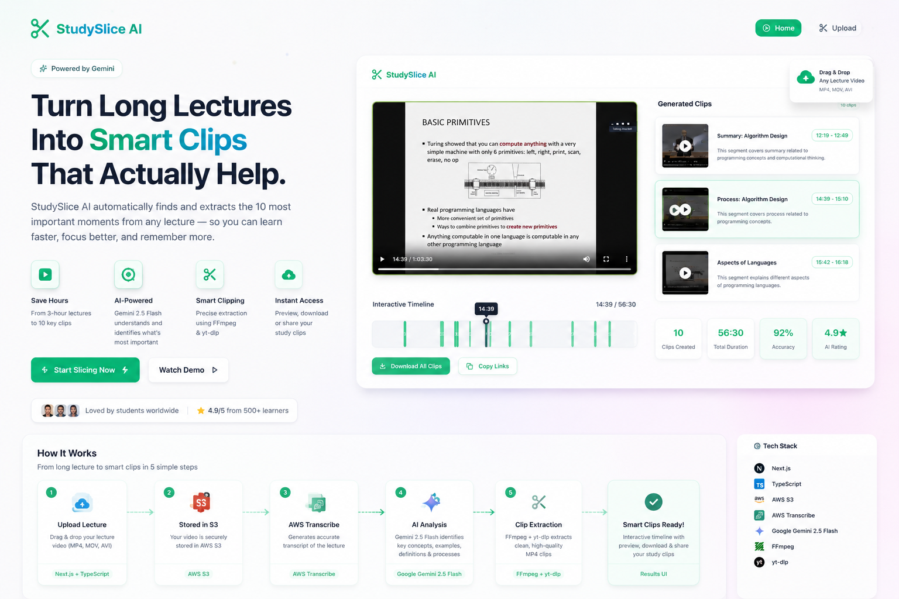
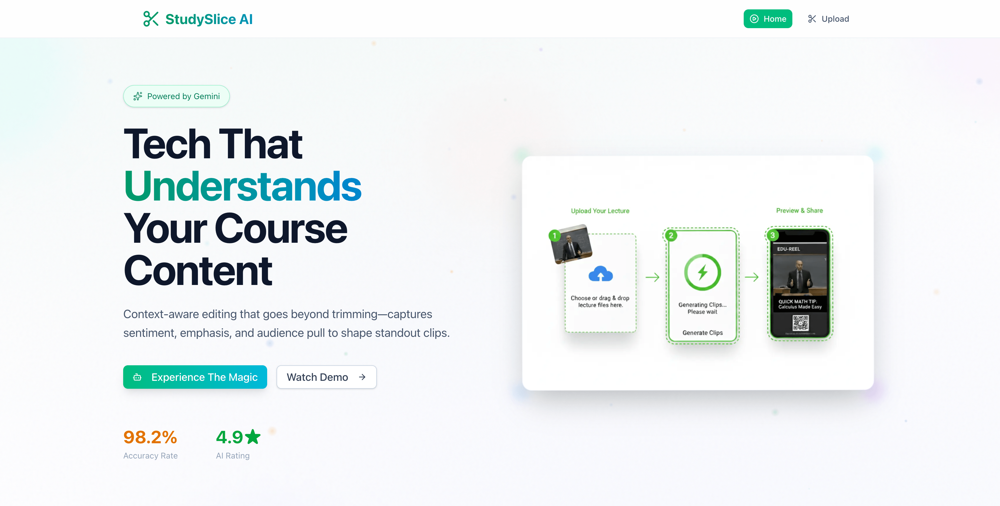
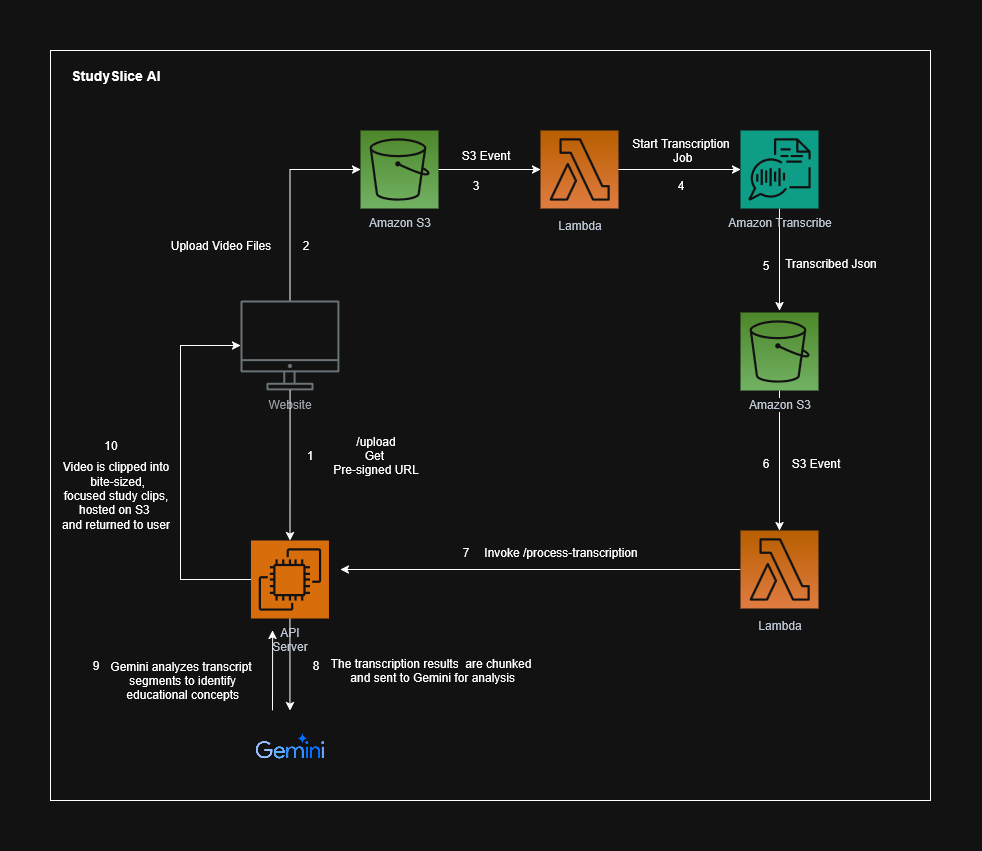
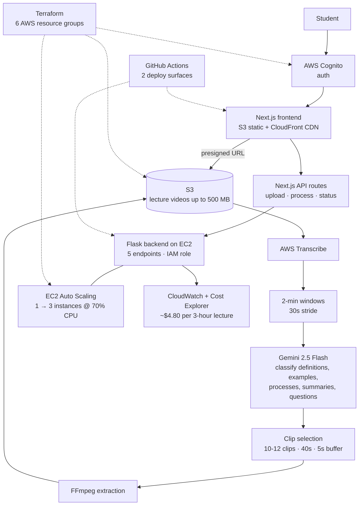
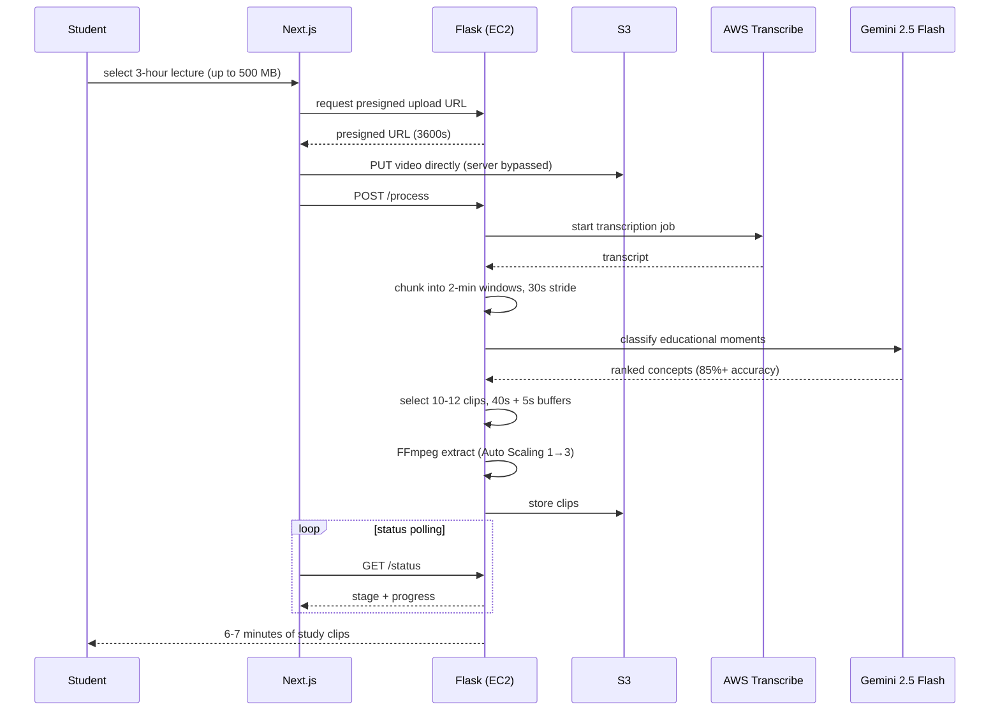
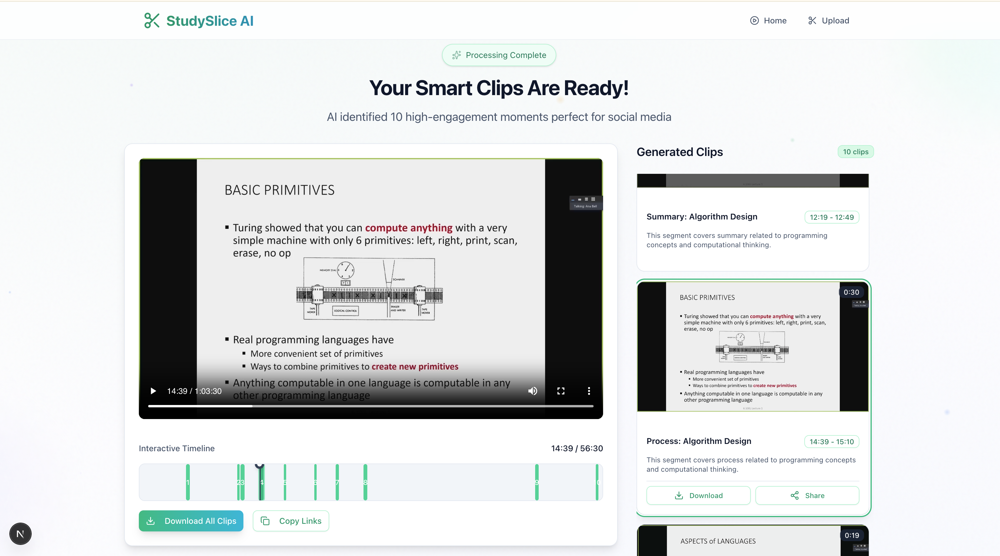

# StudySlice AI — Turn Long Lectures into Smart Study Clips



**🥈 Runner-up, Education Track — SunHacks 2025** (built in 24 hours)

> Turn a 3-hour university lecture into **6–7 minutes** of focused study clips — about a **95% reduction** in review time, while retaining roughly **92%** of full-lecture quiz performance.



---

## Highlights

- Routed lecture-video uploads up to **500 MB** straight to **S3 through presigned URLs** (3600-second expiry), bypassing the frontend server entirely and feeding a transcription and AI clipping pipeline.
- Built the full cloud pipeline end to end: frontend upload → **S3** → **AWS Transcribe** → **Gemini 2.5 Flash** analysis → clip selection → **FFmpeg** extraction → final study clips, with storage, transcription, AI analysis and media encoding as clearly separated stages.
- Configured **EC2 Auto Scaling** for the Flask processing backend with **1 baseline instance**, up to **3 instances** and a **70% CPU target**, so FFmpeg clip extraction does not depend on one fixed server when deadline demand spikes.
- Chunked AWS Transcribe output into **2-minute windows** with a **30-second stride**, giving Gemini enough surrounding context to identify complete educational moments rather than fragments.
- Classified definitions, examples, processes, summaries and key questions with Gemini 2.5 Flash, reaching **85%+ educational concept identification accuracy**.
- Selected **10–12 clips per lecture** at **40-second** windows with **5-second** buffers, so clips never cut a concept mid-sentence.
- Deployed the frontend with **2 services** — S3 static hosting and CloudFront CDN — protected access with **AWS Cognito**, and kept the Flask backend on **EC2 IAM roles** instead of hardcoded credentials.
- Codified **6 AWS resource groups** in **Terraform** — S3, CloudFront, Cognito, EC2, IAM roles and Auto Scaling — making the environment reproducible rather than console-only.
- Built a **GitHub Actions** CI/CD workflow across **2 deployment surfaces** (S3 + CloudFront frontend, EC2 backend) including CloudFront cache invalidation after frontend releases.
- Exposed **5 Flask endpoints** and **3 Next.js API routes** for upload URL creation, transcript processing, status polling, clip retrieval and health checks, so long jobs stay visible.
- Tracked cost and failure signals with **CloudWatch** logs, EC2 utilization metrics and Cost Explorer tagging across **3 pipeline stages**, measuring roughly **$4.80 per 3-hour lecture**.
- Validated learning outcomes, not just time saved: a **12-student** study with **5-question** recall checks retained about **92%** of full-lecture quiz performance at about **95%** less review time.

---

## Architecture





## Upload to clips



---



## Results

| Metric | Value |
|---|---|
| Review-time reduction | **~95%** (3 hours → 6–7 minutes) |
| Quiz performance retained | **~92%** (12 students, 5-question recall checks) |
| Concept identification accuracy | **85%+** |
| Clips per lecture | **10–12** at 40s each |
| Processing cost | **~$4.80** per 3-hour lecture |
| Max upload | **500 MB** via presigned URL |

## Tech stack

**Frontend** Next.js · TypeScript · Tailwind CSS · shadcn/ui · Framer Motion · react-dropzone · Zustand
**Backend** Python Flask · boto3 · CORS · async media processing · status-polling APIs
**AWS** S3 · CloudFront · Cognito · Transcribe · EC2 + Auto Scaling · IAM roles · CloudWatch · Cost Explorer
**AI & media** Google Gemini 2.5 Flash · FFmpeg · yt-dlp
**Infra** Terraform (6 resource groups) · GitHub Actions CI/CD

## Quick start

```bash
git clone https://github.com/Brijesh03032001/StudySliceAI.git
cd StudySliceAI
```

```bash
cd infra && terraform init && terraform apply    # S3, CloudFront, Cognito, EC2, IAM, Auto Scaling
```

```bash
cd backend && pip install -r requirements.txt && python app.py
```

```bash
npm install && npm run dev
```

---

**Built by [Brijesh Kumar](https://github.com/Brijesh03032001)** · [Portfolio](https://brijeshbuilds.com) · [LinkedIn](https://linkedin.com/in/brijeshkumar03)
